<p align="center">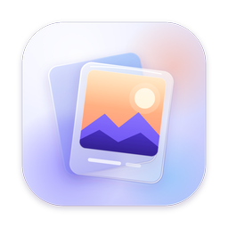</p>

<h1 align="center">Collage</h1>

<p align="center">Photo collages, multi-page photo stories and batch borders. Offline, on your Mac or PC.</p>

<p align="center">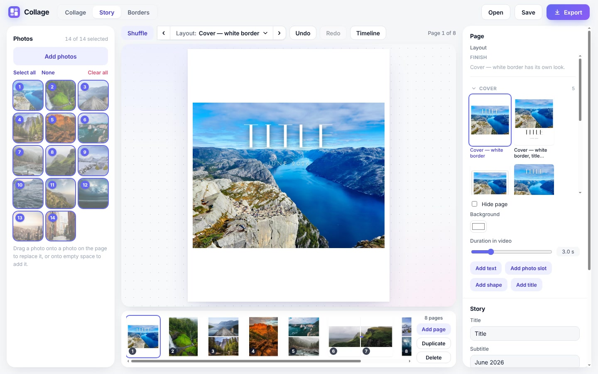</p>

Three tools in one app:

- **Story:** turn a folder of photos into a finished multi-page post (like an Instagram carousel) in one click, then adjust any page. Save it as pictures or as a video with music.
- **Collage:** combine photos into one picture.
- **Borders:** add a white border, black border, mat, frame or polaroid look to many photos at once.

It works without internet, and your photos never leave your computer. It's free.

## Install

### Mac

You need a Mac with Apple silicon (M1 or newer). To check: click the Apple menu (top-left corner of the screen) → **About This Mac**. If it says **Chip: Apple M1** (or M2, M3, M4…), you're set. Macs with Intel chips aren't supported.

1. Download **[Collage-mac-arm64.zip](https://github.com/doglegs-laughs/collage/releases/latest/download/Collage-mac-arm64.zip)** (always the latest version).
2. Open your **Downloads** folder and double-click the zip file. A **Collage** app appears next to it. (Safari sometimes does this for you.)
3. Drag **Collage** into your **Applications** folder.
4. Double-click **Collage** to open it. The first time, your Mac stops it with a message that it can't check the app for malware. This is expected: the app isn't registered with Apple. Click **Done** (or **Cancel**), not Move to Trash.
5. Click the Apple menu (top-left corner) → **System Settings** → **Privacy & Security**, then scroll down to the **Security** section.
6. Next to the message about Collage, click **Open Anyway**. (The button only shows for about an hour after step 4. If you don't see it, do step 4 again.)
7. Enter your Mac password, then click **Open**.

You only do this once. From then on, Collage opens like any other app. Apple explains the same steps in [Open a Mac app from an unknown developer](https://support.apple.com/guide/mac-help/open-a-mac-app-from-an-unknown-developer-mh40616/mac).

<details>
<summary>If your Mac says Collage "is damaged and can't be opened"</summary>

The app isn't damaged; your Mac is being cautious about apps from the internet. To fix it:

1. Press **Command (⌘) + Space**, type **Terminal**, and press **Return**.
2. Copy this line, paste it into the Terminal window, and press **Return**:
   ```
   xattr -dr com.apple.quarantine /Applications/Collage.app
   ```
3. Close Terminal and open Collage again.

</details>

### Windows

Works on Windows 10 and 11.

1. Download **[Collage-Setup-x64.exe](https://github.com/doglegs-laughs/collage/releases/latest/download/Collage-Setup-x64.exe)** (always the latest version).
2. Open the downloaded file.
3. If a blue box says **"Windows protected your PC"**, click **More info**, then **Run anyway**. This appears because the app isn't registered with Microsoft.
4. Click through the installer (**Next**, **Install**, **Finish**). Collage opens when you click Finish, and you'll find it in the Start menu afterwards.

Can't install apps on your PC? Download **[Collage-win-x64.zip](https://github.com/doglegs-laughs/collage/releases/latest/download/Collage-win-x64.zip)** instead, right-click it, choose **Extract All**, and open **Collage.exe** in the extracted folder.

### Updating

Download the new version the same way and replace the old app. Your stories are kept.

## Story

<p>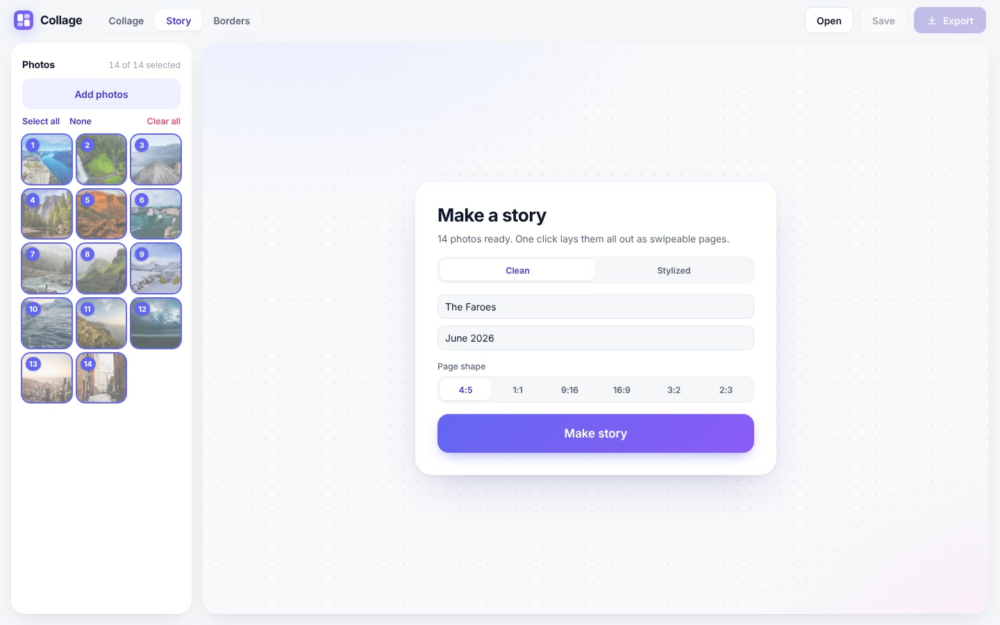</p>

1. Click the **Story** tab, then **Add photos** (or drag photos onto the window). Click a thumbnail to include or exclude it. Double-click a thumbnail (or press Space) for a large preview.
2. Pick **Clean** or **Stylized**, optionally type a title and subtitle, and choose a page shape (4:5 suits Instagram).
3. Click **Make story**. **Shuffle** regenerates the whole story with a different arrangement.

<p>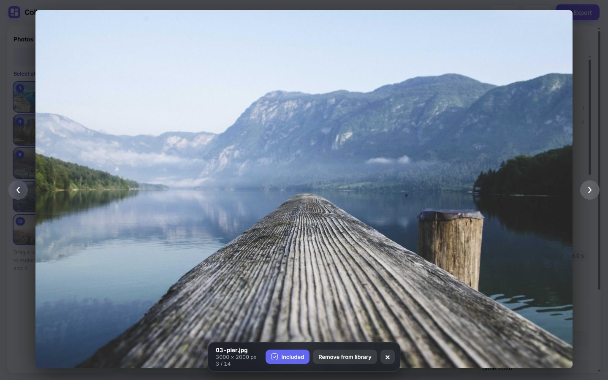</p>

**Styles**
- **Clean:** full-bleed or white-border cover in a thin display title, inset singles, stacks with even white gutters, panoramas across two slides, and an overview grid.
- **Stylized:** matted and framed prints, print mats, polaroids over a blurred photo, seamless splits and tight stacks.

<p>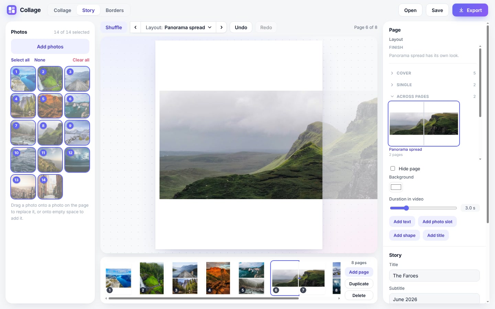</p>

**Layouts: arrangement × finish.** Every page has an *arrangement* (where photos go: single, pair, stack, trio, grid, panorama…) and a *finish* (how they are presented: plain, tight, black borders, print mat, shadow, full bleed). Pick both from the **Layout ▾** menu in the toolbar or the Page panel. Thumbnails show your own photos. Use **‹ ›** to step through arrangements.

<p>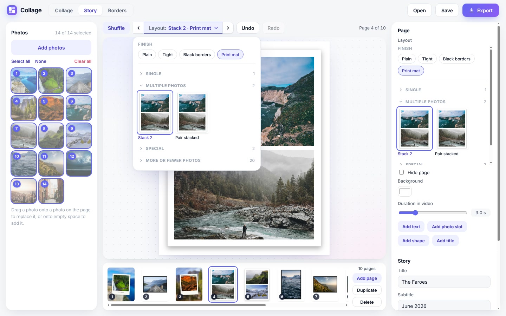</p>

**Editing a page**
- **Drag a photo** to reposition it inside its box. **Scroll or pinch** to zoom.
- **Double-click a photo** to move or resize its box. Esc or click outside to finish.
- **Right-click** for Move to its own page, Replace photo, Reset crop, Duplicate, layer order and Delete.
- **Titles:** type a title in the Story panel, then **Add title page** or **Add to this page**. Fonts include Italiana, Playfair, Montserrat, Josefin Sans, Cormorant, Bebas Neue, Caveat, DM Mono and more, all bundled offline.
- **Pages:** drag thumbnails in the bottom strip to reorder. Click one and press Delete to remove it. Use the eye button to hide a page without deleting it; hidden pages are skipped on export.

<p>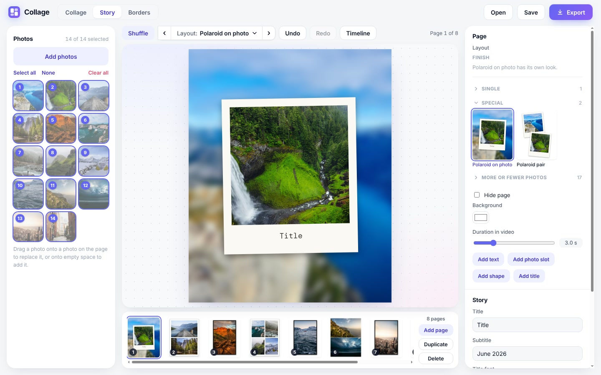</p>

**Export** (top right)
- **Images:** one JPEG per page at 1080 or 2160 px wide, numbered in order.
- **Video:** an MP4 with crossfades and a slow zoom, optionally with music, with "fit to music" timing. Panoramas that span two slides pan left to right.
- **Beat sync:** pick music, turn on **Sync photo changes to beats**, and choose **1, 2, 4 or 8 beats per page**. The app finds the rhythm on your computer and cuts on the beat, with no transition by default (you can still pick a crossfade, centred on the beat). Hidden pages are skipped and short tracks loop. Music with a clear rhythm works best; files up to 25 minutes.
- **Timeline:** fine-tune timing by hand (see below).

### Timeline

<p>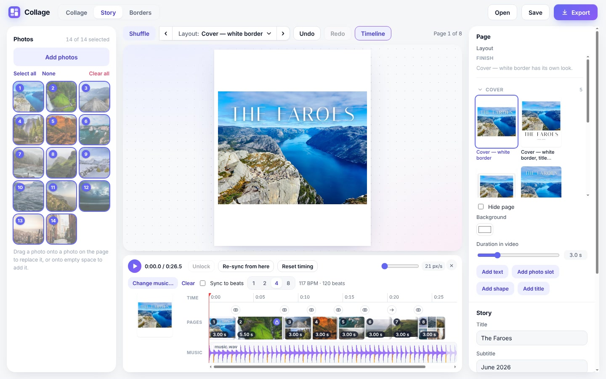</p>

Optional. Click **Timeline** in the Story toolbar (or **Edit timing…** in the video dialog) to swap the page strip for a timeline.

- **Pages** are blocks as wide as their length. Drag a block's right edge to stretch or shorten it; it snaps to nearby beats (hold Alt to turn snapping off). Double-click to type an exact length.
- **Music** shows below as a waveform with beat marks (taller every 4th beat). Choose a track, press **Analyze music**, then drag the music sideways to pick where in the song the video starts.
- **Transitions:** click the icon between two blocks to cycle cut, crossfade and slide.
- **Locks:** a stretched page shows a lock. **Unlock** or **Re-sync from here** returns it, and the pages after it, to automatic timing. **Reset timing** clears every edit.
- **Preview:** the play button (or Space) plays the timeline with the music.

Every change is one undo step and is saved with the story. With no edits, export works as before. **Fit to music length** stretches only the pages you have not adjusted.

**Saving:** stories autosave and reopen where you left off. **Save** / **Open** (⌘S / ⌘O) keep named copies, and File → Open Recent lists the last ten.

## Collage

<p>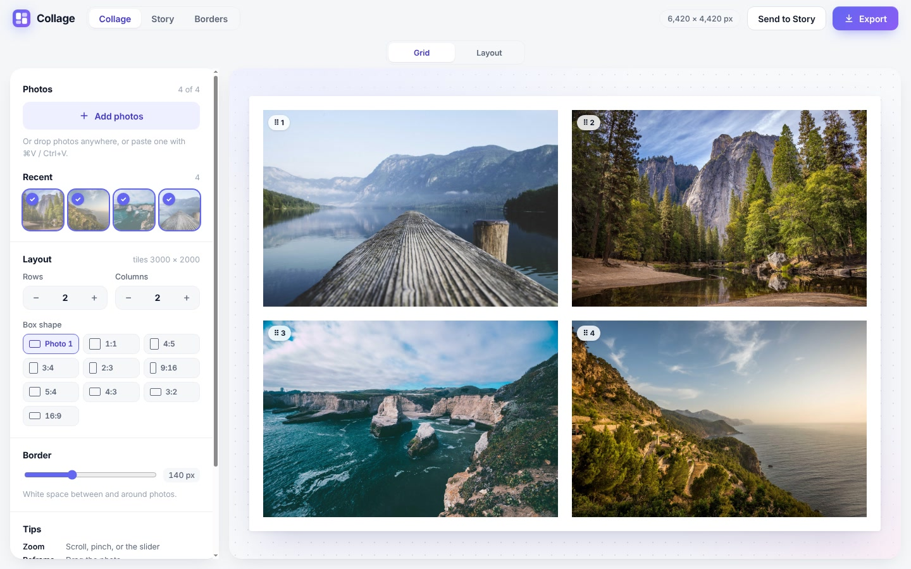</p>

- **Grid:** rows × columns (1–20), ten box shapes, and a white border sized automatically. Drag inside a box to reframe, scroll to zoom, and drag the ⠿ badge to swap. The export keeps photo 1 at full resolution.
- **Layout:** any Story arrangement and finish as a single image, with page shape, background, spacing and an export size of up to the photos' own resolution.

**Send to Story** adds the finished collage to your story's photos.

<p>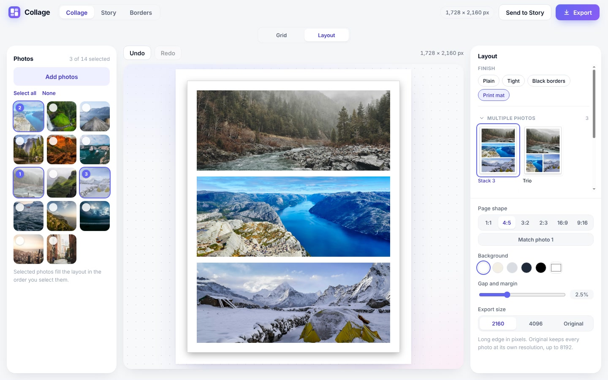</p>

## Borders

<p>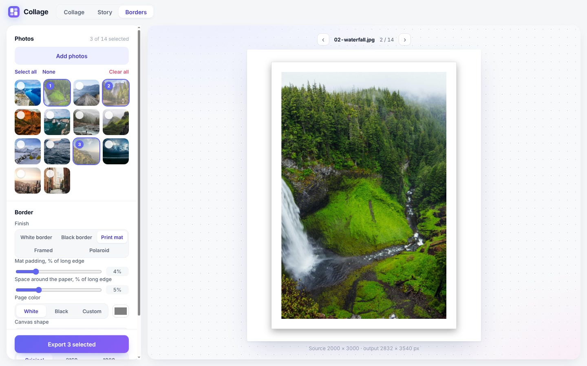</p>

Pick a finish (**White border, Black border, Print mat, Framed, Polaroid**), the border size, colour, canvas shape (Original, 1:1, 4:5, 9:16) and output size, then **Export all** to a folder. Each photo is saved as `<name>-border.jpg`, and existing files are never overwritten.

## Shortcuts

| Keys | Action (Story) |
|---|---|
| ⌘Z / ⇧⌘Z | Undo / redo (Ctrl on Windows) |
| ⌘S / ⌘O | Save / open story |
| ⌘D | Duplicate selection |
| ⌘A | Select all on page |
| ⌘⇧N | Move selected photo to its own page |
| ⌘⇧H | Hide or show the current page |
| ⌘] / ⌘[ | Bring forward / send backward (add ⇧ for front/back) |
| Delete | Remove selection, or the page selected in the strip |
| Arrows | Nudge selection (⇧ ×10), or change page when nothing is selected |
| ] / [ | Next / previous arrangement |
| } / { | Next / previous finish |
| Space | Large preview of the focused thumbnail |
| Esc | Deselect, or leave box-moving mode |

## For developers

Electron + React + TypeScript (Vite). ffmpeg (bundled) handles video.

```
npm install
npm run dev          # Vite + Electron with reload
npm test             # unit tests (Vitest)
npm run e2e          # Electron end-to-end tests (Linux: xvfb-run -a npm run e2e)
npm run dist:mac     # release/Collage-mac-arm64.zip, ad-hoc signed
npm run screenshots  # regenerate docs/screenshots (node scripts/screenshots.mjs <photo folder>)
```

Design notes and data contracts: [`docs/PLAN.md`](docs/PLAN.md).

**CI and releases.** [`.github/workflows/build.yml`](.github/workflows/build.yml) builds the Mac app and the Windows installer and zip on every pull request and push to `main`. The downloads are attached to each run. When a push to `main` changes `version` in `package.json`, the `release` job publishes GitHub Release `v<version>` with all three files once both builds pass.

Sample photos in the screenshots are from [Unsplash](https://unsplash.com) (Unsplash License).
